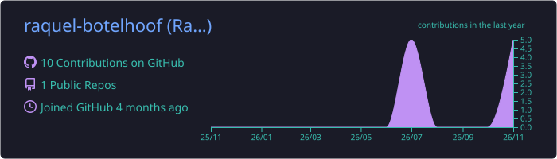
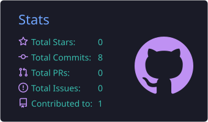
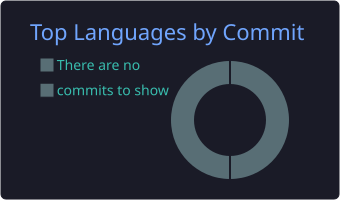

  

<h1 align="center">Raquel Botelho</h1>

  

  
  
  
  

---

## 💜 Sobre mim · About me

<table>
<tr>
<td width="50%" valign="top">
🇧🇷 <b>Português</b>
<ul>
  <li>🤖 Desenvolvedora com foco em <b>IA aplicada</b> e <b>entrega de valor</b></li>
  <li>🎯 Uso IA para resolver problemas reais e gerar resultado para o negócio</li>
  <li>⚡ Automatizo e acelero o desenvolvimento com <b>Claude Code</b> e agentes de IA</li>
  <li>🗄️ Base sólida em <b>Oracle, PL/SQL</b> e sistemas corporativos</li>
  <li>📚 Estudando <b>Angular, TypeScript e .NET (C#)</b></li>
  <li>🌌 Fora do código: gatos, jogos de FPS, ficção científica e trilhas</li>
</ul>
</td>
<td width="50%" valign="top">
🇺🇸 <b>English</b>
<ul>
  <li>🤖 Developer focused on <b>applied AI</b> and <b>value delivery</b></li>
  <li>🎯 I use AI to solve real problems and drive business results</li>
  <li>⚡ I automate and speed up development with <b>Claude Code</b> and AI agents</li>
  <li>🗄️ Solid background in <b>Oracle, PL/SQL</b> and enterprise systems</li>
  <li>📚 Currently learning <b>Angular, TypeScript and .NET (C#)</b></li>
  <li>🌌 Away from code: cats, FPS games, sci-fi and hiking</li>
</ul>
</td>
</tr>
</table>

---

## 🚀 Principais skills · Main skills

  
  
  
  
  
  
  

## 📚 Estudando agora · Currently learning

  
  
  
  
  
  
  

---

## 📊 Estatísticas · GitHub stats

  

  
  

  

---

  <i>“Somewhere, something incredible is waiting to be known.” — Carl Sagan</i> 🌌

<!-- Footer -->

  

